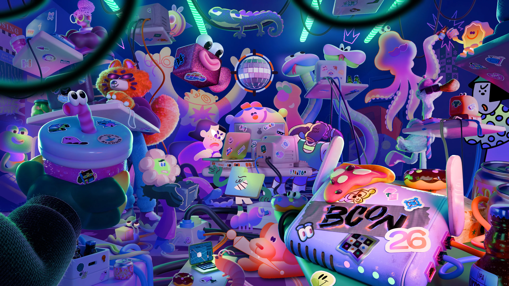
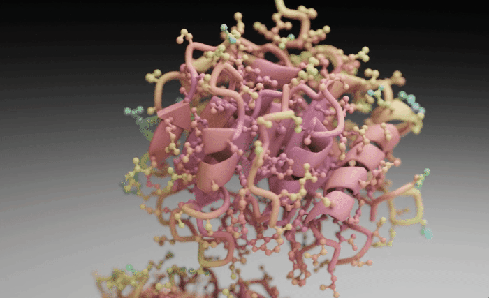
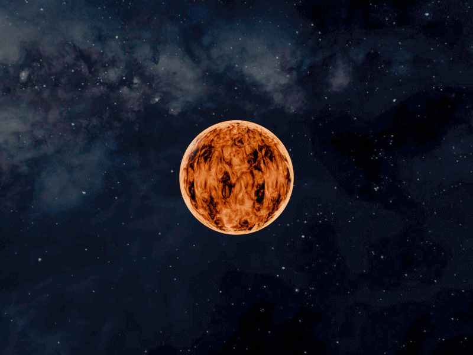

Intro  text here.

<figure>
  
  <figcaption>Short visible caption. Add credit/source links here when needed.</figcaption>
</figure>

On the 23rd to the 25th of September this year, I had the privilege to attend the annual 
[Blender conference](https://conference.blender.org/2026/). Blender is open source application packed with tools for 
everything surrounding 3d modeling and rendering, VFX, 2D and 3D animation, and video editing. Moreover, SOMETHING 
WITH ADDONS.

For years, I have been wondering whether this tool that I've been dabbling in could also have useful applications for
our research software projects. I knew there were scientific applications out there, such as the 
[Molecular Nodes addon](https://bradyajohnston.github.io/MolecularNodes/), which provides tools for easy loading of 
molecular data. However, I have also come across struggles with scientific applications that make me think whether 
other 3d visualization tools are to be preferred. The thing about being a research software engineer is that we are 
usually developing scientific tools for other people to use. If these researchers are not familiar with working in 
Blender I would usually consider other tooling first that have a less steep learning curve. On the other hand, 
I am wondering if in the right usecase it might be worth it to teach our project partners this powerful tool.

<figure>
  
  <figcaption>Short visible caption. Add credit/source links here when needed.</figcaption>
</figure>

## Simulation plugins
I have seen quite a few talks where blender is used in combination with external simulation libraries. These 
simulations usually already have tools available for  scientifically accurate visualization in jupyter notebook and 
the like. The blender addon is then used to breathe life into the results, and can result in beautiful imagery. One 
example of this was [Ben de Vries' talk on the creation of a blender addon to visualize stellar evolution]
(https://youtu.be/GWDBv79Veiw?si=jK9VtY-0lImYQXeA). His tool, Tulips3d, is a 3d version of Tulips, which is a tool 
to visualize stellar evolution.

Blender is definitely useful for making beautiful pictures, but can also play a huge role in the design of a simulation
scene. Felipe Oliveira Ribas discussed his use of 
[ray-tracing simulations for analyzing radio wave propagation](https://youtu.be/tUAMVAh3OMo?si=kLI3qbNvTx29Xoqk)
. He uses the open source tool [Sionna RT](https://nvlabs.github.io/sionna/rt/index.html) for modeling radio wave 
propagation. However, the tools to create the simulation environment are often quite limited and static. He 
developed a plugin to run these radio propagation simulations directly in blender, and illustrated how blender's 
geometry nodes can be a powerful tool to easily create variations on scenarios. He showcased how he created procedural
greenhouses that can be tweaked to any size, and showed how he used blender's tools to generate plants that he could 
set to any point in their growth cycle. Sionna RT was then used to analyze how these plants affected the propagation 
of radio waves through the space. This resulted in a heatmap that was visualized right in the 3d environment.  

Another impressive combination of simulation and blender was presented by Shravan Tata Ramalingasetty on
["Neuromechanical Modeling and Simulation of Animals and Robots"](https://youtu.be/vjJT5kCru04?si=3ZpSiqUCmsMwoBXf). 
In his lab

EM propagation, diagram of combining blender and simulation tools
Farms, combining fysiology, neuron simulation and physics simulation

# Stellar Evolution
Clear example of scientific application

<figure>
  
  <figcaption>Short visible caption. Add credit/source links here when needed.</figcaption>
</figure>

# Collaborating in big teams on cinematic data visualization
Using blender with git. They do struggle with node trees being verbose

# Building node trees with code by Brady Johnston
Brady Johnston had a solution for the verbosity. A new package to convert node trees to simpler code and vice versa.

# Graph Visualization
Tool for beautiful data visualization.

# Scientific data on surfaces
Overcoming issues around displaying data accurately in blender

## Conclusion
Blender makes data come alive
Easy procedural models with geometry nodes
Thriving community.

TODO: 
- Add speakers' affiliations
- 